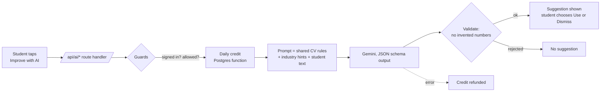

<div align="center">

# CV11

**A free CV builder and job-hunt toolkit made for students and graduates in Ghana.**

Build a clean, ATS-friendly CV in minutes, write a cover letter, check your CV before you send it, and prepare for interviews. Free, fast on a phone, and your CV never leaves your device.

[**Live site → cv11-one.vercel.app**](https://cv11-one.vercel.app)


</div>

---

> **Want the full picture?** [`docs/PROJECT-GUIDE.md`](docs/PROJECT-GUIDE.md) explains the whole product, the business model, the architecture, every folder and file, the database, the key flows, the settings and the rules for working in the code. It is written for investors and for any developer (human or AI) taking over the project.

## Why this exists

Most CV tools are built for people in the US or Europe. They put basic features behind a paywall, ask for an account before you can download, and give a Ghanaian final-year student nothing that fits their situation: national service, attachment, a first CV with no job history.

CV11 is built around that student. It is free to use, needs no sign-up, works well on a low-end phone, and its examples, advice and templates come from the Ghanaian job market.

## What it does

| Tool | What you get |
|---|---|
| **CV builder** | Step-by-step builder with live preview, 30+ templates, photo support, reorderable entries, and one-tap PDF or Word download. |
| **CV versions** | Make the same CV in up to 10 looks, one for each company: pick a template (mixed or all the same), a colour and a role line for each, then download every version as its own real-text PDF, named after the company. The print code is shared with the builder, so quality is identical and the CV never leaves the device. |
| **Course examples** | Ready-made example CVs by field (medicine, IT, nursing, business and more) so a student can see what a strong CV in their area looks like. |
| **CV checker** | Upload a CV and get a score with specific fixes: weak verbs, missing numbers, length, and the keywords recruiters in your industry expect. |
| **Cover letters** | Guided letters in the formal Ghanaian layout, with sender and recipient addresses and a drawn or uploaded signature. |
| **Text to PDF** | Turn any text, a letter, notes or even code, into a clean PDF, tap a line to edit it, and sign it. |
| **Certificate sharing and verification** | Instead of sending a file to every person, an organiser shares one link or QR code: each person types their own name and downloads only their own certificate (the list is never shown). Names can be pasted by the organiser or added by attendees themselves, then released. Links can be managed (code, expiry, add or fix names), certificates carry a verify QR that opens a "this is genuine" page, and some designs have an optional award rosette. Needs `supabase/share.sql`. |
| **Bulk certificates** | Paste a list of names, pick one of 35 designs (wide and tall, drawn as vector art with real gradients, wreath medals and ribbons), and download a certificate for every person as a ZIP of separate PDFs or one PDF to print. Free for up to 15 per batch. Names are cleaned automatically (capitals, numbering, duplicates), long and Ghanaian-letter names fit, and everything is made on the organiser's own device. |
| **Interview prep** | Common questions by field with guidance on how to answer. |
| **Application tracker** | Keep track of where you applied and what happened. |
| **Voice input** | Say what you did in your own words and get tidy CV lines back. |
| **Accounts (optional)** | Save a CV to the cloud, move between devices, or keep a backup file. Everything works without an account. |

## Design principles

- **Private by default.** The CV you build is stored in your browser. Files you upload for import or checking are read in the browser and never sent to a server. The only exception is the optional AI button, described below, which says so before it is first used.
- **Fast on a bad connection.** Marketing pages are prerendered. Heavy libraries (the Supabase client, PDF and Word tools) are loaded only when a feature needs them, so a visitor who never logs in never downloads the auth library.
- **Honest.** No invented testimonials, no fake counters, no dark patterns. Pricing and limits are stated plainly.
- **Accessible and mobile-first.** Built and checked at phone width first, with labelled controls and keyboard support.

## Engineering highlights

This project is a good example of shipping a real product end to end, not just a UI.

- **Next.js 16 App Router** with route groups, static prerendering and streaming. Pages are static by default; dynamic work is pushed into small client components.
- **A config-driven template engine.** Most CV templates are produced from small configuration objects (heading style, entry style, header style, sidebar or single column) by two shared renderers, instead of one hand-written component per template. A new template is mostly a config entry. Layout fitting keeps every template within A4 pages.
- **Client-side document pipeline.** PDF generation with `pdf-lib` and embedded Unicode fonts, PDF text extraction with `pdfjs-dist`, and Word import and export with `mammoth` and `docx`. Letter detection places a signature after the closing line of a letter, and a tap-to-edit layer maps each rendered line back to its text.
- **Supabase backend with row-level security.** Auth with email confirmation, a cloud-sync table, and an owner-only analytics dashboard served by `security definer` SQL functions. The app only ever uses the public anon key; no service-role key exists anywhere in the codebase or the deployment.
- **Privacy-respecting analytics.** Vercel Analytics plus a small first-party event table keyed by a random browser code, with the owner's own devices excluded, so the numbers reflect real students.
- **Design system by tokens.** Colours and radii live in CSS variables and a Tailwind v4 `@theme`, with separate light, dark and neutral (admin) palettes.

### The AI layer

AI suggestions help students who find writing about themselves hard: rewrite a bullet, tighten a project description, draft a summary. The design is deliberately cautious.



- **Server only.** All AI code lives in `src/server/ai/` and is marked `server-only`, so the API key cannot reach the browser. Route handlers under `src/app/api/ai/` are thin, and one shared skeleton handles checks and errors.
- **Never invents facts.** One rules file is added to every prompt: do not add numbers, tools, duties or results the student did not state. A post-check rejects any answer that contains a number the student never gave.
- **Industry-aware.** The prompt receives the keywords recruiters expect in the student's field, taken from the same data the CV checker uses.
- **The student stays in control.** A suggestion is shown with a one-sentence reason and two buttons. Nothing is ever replaced automatically, and editing the text hides a stale suggestion.
- **Limits that hold.** A Postgres function takes one credit per request atomically, enforcing a per-person and a whole-site daily cap that can be changed in a table without a deploy. If the AI fails, the credit is refunded. If the limits are not installed, the AI refuses to run rather than run uncounted.
- **Prompt-injection aware.** Student text is wrapped as data and the model is told never to follow instructions inside it.
- **Consent.** Before first use the student is told exactly what is sent to Google's AI and what is not (never the name, phone or email), and the privacy page documents it.

Status: the AI is currently switched on for the site owner only while quality is tested. Opening it to students is one environment variable (`AI_ACCESS=everyone`).

### Payments

Building and previewing a CV is free. Downloading it costs GH₵ 7, paid once through [Paystack](https://paystack.com) (mobile money or card), and unlocks that one CV for 30 days.

- **Sign up, then pay, then download.** A student who taps Download without an account is sent to sign up, and is brought back to their CV afterwards, even after confirming an email in another tab.
- **The server never trusts the browser.** The price and rules live in Postgres (`supabase/payments.sql`). Our server asks Paystack directly whether the money arrived, and only then calls a database function that unlocks the CV. That function needs a secret that only the server holds, so a student cannot mark their own payment as paid. Paystack's webhook is verified with an HMAC-SHA512 signature, and a payment is safe to confirm twice.
- **No service-role key.** Even the server only uses the public anon key. Everything it may do is limited by row-level security and by those database functions.
- **Switched off by default.** Nothing is charged, and no copy on the site changes, until `NEXT_PUBLIC_PAYMENTS_ENABLED=true`. Every "free" claim on the site follows that same switch.

## Project structure

```
src/
├─ app/
│  ├─ (marketing)/       Public pages: home, templates, examples, letters, checker, blog, pricing, legal
│  ├─ (auth)/            Full-screen log in, sign up and password reset
│  ├─ builder/           The CV builder
│  ├─ cover-letter/      The cover letter builder
│  ├─ admin/             Owner-only analytics dashboard and AI test bench
│  └─ api/ai/            Thin AI route handlers (one file per feature)
├─ components/
│  ├─ builder/ cv/ checker/ tools/ tracker/   Feature UI
│  ├─ auth/ admin/ marketing/ ui/             Account, owner and shared UI
├─ lib/                  Pure logic: templates, CV rules, checker, PDF, import, sync, analytics
└─ server/ai/            Server-only AI: config, Gemini client, guards, rules, validation, features
supabase/
├─ schema.sql            Tables, row-level security, admin functions
├─ stats.sql             Analytics queries
├─ ai.sql                AI usage limits
└─ payments.sql          Payments, price and download access
docs/                    Manual test checklists
```

## Getting started

Requires Node.js 20+.

```bash
git clone https://github.com/caleboss20/CVbuilder.git
cd CVbuilder
npm install
cp .env.example .env.local   # then fill in the values below
npm run dev
```

Open <http://localhost:3000>. The builder, checker, templates and PDF tools all work with no environment variables at all.

### Environment variables

| Variable | Needed for | Notes |
|---|---|---|
| `NEXT_PUBLIC_SUPABASE_URL` | Accounts, cloud sync, analytics | Safe to expose. |
| `NEXT_PUBLIC_SUPABASE_ANON_KEY` | Accounts, cloud sync, analytics | The public anon key only. Never use a service-role key. |
| `GEMINI_API_KEY` | AI suggestions | Server only. Never prefix with `NEXT_PUBLIC_`. |
| `GEMINI_MODEL` | AI suggestions | Optional. Defaults to `gemini-3.5-flash-lite`, which has the largest free allowance. |
| `AI_ACCESS` | AI suggestions | `admin` (default) or `everyone`. |
| `PAYSTACK_SECRET_KEY` | Payments | Server only. Use a `sk_test_` key until you go live. |
| `PAYMENT_CONFIRM_SECRET` | Payments | Server only. Copy `confirm_secret` from the `pay_settings` table after running `payments.sql`. |
| `NEXT_PUBLIC_PAYMENTS_ENABLED` | Payments | `true` turns the paywall on. Leave unset until the three above work. |
| `NEXT_PUBLIC_WHATSAPP` | Support button | Optional, digits with country code. |

### Database setup (optional)

In the Supabase SQL editor, run `supabase/schema.sql`, then `supabase/stats.sql`, then `supabase/ai.sql`, then `supabase/payments.sql`. Add your own email to the `admins` table to see the dashboard at `/admin`.

### Scripts

```bash
npm run dev     # development server
npm run build   # production build
npm run start   # serve the production build
npm run lint    # ESLint
```

## Quality checks

- Type-checked with strict TypeScript, linted with ESLint, and production-built before each release.
- Manual device checklist in [`docs/phone-test-checklist.md`](docs/phone-test-checklist.md) for the flows that matter most on a real phone: building, downloading, signing and signing in.

## Roadmap

- [x] CV builder, 30+ templates, course examples, checker, cover letters, Text to PDF
- [x] Optional accounts with cloud sync and file backup
- [x] Owner analytics dashboard
- [x] AI suggestions for bullets, projects and summaries, with daily limits and consent
- [ ] Voice clean-up that shows "we heard" against "we think you meant"
- [ ] Suggestions while typing, using the free rule-based coach first
- [x] Pay-per-CV download with Paystack (built; switched on after test-mode checks)
- [ ] More fields, templates and letter types

## Author

Built by [@caleboss20](https://github.com/caleboss20).

If you are a student in Ghana, the site is free: **[cv11-one.vercel.app](https://cv11-one.vercel.app)**.
