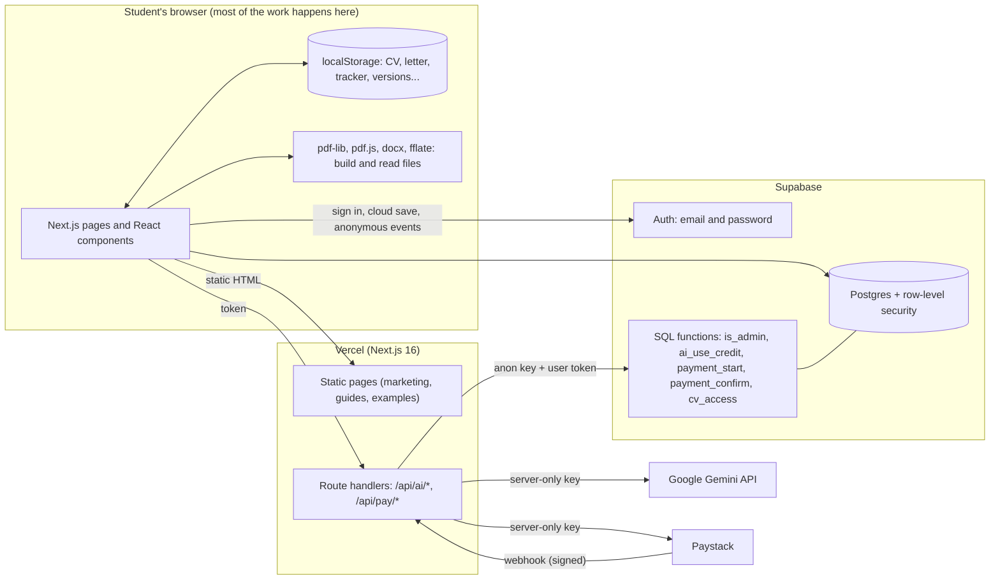

# CV11: Project Guide

> **Who this is for.** Two readers. **Investors and partners** get the product, the problem, the business model and the honest state of things in sections 1 to 6. **Developers (human or AI) who take over this codebase** get the architecture, the file-by-file map, the data model, the flows, the setup and the rules in sections 7 to 16. Everything here describes what is actually in the repository. Where something is planned but not built, it says so.
>
> Last updated: 20 October 2026. Live site: <https://cv11-one.vercel.app>. Repository: `caleboss20/CVbuilder`, branch `main`.

---

## Contents

1. [CV11 in one page](#1-cv11-in-one-page)
2. [The problem and the people we serve](#2-the-problem-and-the-people-we-serve)
3. [What the product does](#3-what-the-product-does)
4. [How CV11 makes money](#4-how-cv11-makes-money)
5. [Why it can win](#5-why-it-can-win)
6. [Honest status, risks and what is next](#6-honest-status-risks-and-what-is-next)
7. [Design principles](#7-design-principles)
8. [Architecture](#8-architecture)
9. [Technology stack](#9-technology-stack)
10. [Repository map: what every folder and file does](#10-repository-map-what-every-folder-and-file-does)
11. [Data: the database and the browser](#11-data-the-database-and-the-browser)
12. [Key flows, step by step](#12-key-flows-step-by-step)
13. [Configuration: environment variables and switches](#13-configuration-environment-variables-and-switches)
14. [Running it, deploying it, setting up the backend](#14-running-it-deploying-it-setting-up-the-backend)
15. [Rules for working in this codebase](#15-rules-for-working-in-this-codebase)
16. [Decision log: why things are the way they are](#16-decision-log-why-things-are-the-way-they-are)

---

## 1. CV11 in one page

**CV11 is a free CV builder and job-hunt toolkit made for students and fresh graduates in Ghana.** A student can build a clean, applicant-tracking-friendly CV on a phone in minutes, check it before sending, write the letters that go with an application, practise for interviews, and keep track of where they applied. A second product line, a **bulk certificate maker**, lets anyone running an event or programme produce a finished certificate for every attendee from a pasted list of names.

The two ideas that shape everything:

- **Privacy by default.** The CV a student builds lives in their own browser. Files they upload for checking are read on their device and never sent to a server. This is unusual for a CV tool and is a real selling point in a market where CVs carry phone numbers and home addresses.
- **Built for Ghana, free to start.** Course-specific example CVs (medicine, IT, nursing, accounting and more), the formal Ghanaian letter layout, a national service checklist, mobile-money payments, and pricing a student can afford.

### The products at a glance

| Product | Who uses it | What it does | Money |
|---|---|---|---|
| **CV builder** | Students, graduates | Step-by-step editor, live A4 preview, 38 templates, PDF and Word download | Free to build. A one-time download fee (built, switched off until payment keys exist) |
| **CV versions** | Students applying to many places | The same CV in up to 10 looks, one per company, each its own PDF | Included in the CV download payment |
| **CV checker** | Anyone with a CV | Upload a CV, get a score out of 100 and specific fixes | Free |
| **Letters** | Students | 8 letter types in the formal Ghanaian layout, with a signature | Free |
| **Text to PDF and letter signing** | Anyone | Turn pasted text or an existing letter into a signed PDF | Free |
| **Interview prep, tracker, national service checklist** | Students | Practice questions by field, an application tracker, a checklist | Free |
| **AI writing help** | Students | Rewrites a bullet, a project description or a summary; fixes misheard voice input | Built, owner-only while quality is tested |
| **Bulk certificate maker** | Event organisers, clubs, schools, training centres | Paste names, pick one of 23 designs, download a certificate for each person | Free up to 10 per batch; paid tiers planned |

---

## 2. The problem and the people we serve

**Students.** A final-year student in Ghana usually has no job history, little idea how a CV should look, and a phone rather than a laptop. Most CV tools are built for the US and Europe: they ask for an account before letting you download, put basic features behind a paywall, and give no help with the local things that matter (national service, attachments, a first CV with no work history). Students end up retyping a Word file, paying a cafe, or sending a CV that automated screening software cannot read.

**Event organisers.** Student leaders, clubs, churches, NGOs and small training centres regularly need 50 to 500 certificates. Today they design one in Canva or Word and retype each name, or fight with a mail merge. It is slow, error-prone and repeats after every event.

**What we observed in the market.** A local competitor (HerbbyCV) charges GH₵ 9 per CV download and offers bulk certificates, so paying for a finished CV download is an accepted model here. We did not see refund or payment terms on its public pages, and its privacy policy says it collects CV content.

---

## 3. What the product does

Status key: **Live** = on the public site today. **Built, off** = finished and tested but switched off by a setting. **Built, owner-only** = finished, visible only to the owner while quality is checked. **Planned** = not built.

### 3.1 CV builder (Live)

- **Start in three ways:** pick a course (examples for about 30 fields of study, plus matching for any course typed in), upload an existing CV to continue editing it, or start blank. A short three-question guide picks the right *type* of CV (standard, graduate, skills-based, academic) so students never need to know the difference.
- **Editor:** steps for personal details, summary, education, experience, projects, skills, extras and references, in an order that depends on the CV type. Dimmed placeholder text from the chosen course's example shows students what good looks like without ever writing it into their CV.
- **Live preview:** the full A4 page, scaled to fit any screen. A short CV is stretched to fill the page; a long one is shrunk to fit one page.
- **Coaching with no AI:** a quiet line under each bullet point (weak opener, missing number, too long) and tappable stronger opening words; a summary starter drafted from what the student already typed; a keyword matcher that compares a pasted job advert with the CV and adds missing skills in one tap.
- **38 templates**, config-driven (see 8.4). Colour picker, template advice per field of study, "ATS-safe" tags with a plain-language explanation.
- **Export:** PDF (through the browser's print engine, so the text stays real and readable by hiring software) and an editable Word file.
- **Safety net:** autosave in the browser, a downloadable backup file, restore on a new phone, and optional cloud save for signed-in users.
- **Voice input:** speak what you did; the words are tidied into CV lines (rule-based, no AI needed).

### 3.2 CV versions (Live)

For students applying to many places. From the finished CV, make up to 10 *versions*. Each version is just a template, a colour and a role line laid over the one saved CV, so editing the CV updates every version. Choose "a different template for each" or "the same for all". Each version downloads as its own PDF named after the company, for example `Akosua_Mensah_MTN_Ghana_Data_Analyst_Intern_CV.pdf`. When payments are on, one payment for a CV covers all its versions for 30 days.

A browser can only save a PDF through its print dialog, so "Download all" prints the versions one after another and the browser asks to save each. This keeps every file a real, text-based PDF and keeps the CV on the device (see decision D2 in section 16).

### 3.3 CV checker (Live)

Upload a PDF or Word CV (or one built in the builder). It is read in the browser, split into sections and bullets, and scored out of 100 by plain rules: action verbs, numbers, length, filler phrases, contact details, and the keywords recruiters in the chosen industry expect (10 industries). It can hand the CV to the builder to fix, and produces a shareable score picture drawn in the browser.

### 3.4 Letters, signing and Text to PDF (Live)

- **8 letter types:** job, internship, national service, scholarship, university admission, reference request, thank-you, follow-up. Guided fields, the formal Ghanaian layout (sender and recipient addresses, salutation, closing) or a style that matches the CV, an optional drawn or uploaded signature.
- **Sign a letter you already have:** upload a PDF, Word file or photo; the tool finds the closing line and places the signature there.
- **Text to PDF:** paste a letter, assignment or code and download a clean PDF; tap any line to edit it; add a title; sign it. Handles Ghanaian letters (Ɛ, Ɔ) through an embedded Unicode font.

### 3.5 Interview prep, tracker, national service checklist (Live)

Interview questions for 9 fields, each with what the interviewer is really looking for and how to build an honest answer. An application tracker (stages and follow-up reminders). A national service preparation checklist. All saved on the student's device.

### 3.6 Accounts (Live, optional)

Email and password through Supabase, with email confirmation and password reset. An account is never needed to build a CV. It is used for cloud save, and (when payments are on) to tie a payment to a person.

### 3.7 AI writing help (Built, owner-only)

Four small features behind **Improve with AI** and **Check what we heard** buttons: rewrite a bullet, tidy a project description (and ask the one question that would add the missing result), write or improve a summary, and correct likely speech-recognition mistakes ("canoes" becomes KNUST, "re act" becomes React, "core bu" becomes Korle Bu). Design points that matter:

- The AI **never invents facts**. A strict rules file is added to every request, and after the answer comes back a check rejects any number the student did not write.
- The student **always chooses**: a suggestion appears with a one-sentence reason and "Use this" / "Dismiss". Nothing is replaced automatically.
- For voice, the AI only *proposes* word pairs ("heard", "meant"); our own code checks each pair and does the replacing, so the AI cannot rewrite the student's sentence.
- Limits are enforced in the database (5 free requests per student per day, 450 per day for the whole site by default), and a failed request gives the credit back.
- A consent note appears before the first use, and the privacy page documents exactly what is sent.
- Currently restricted to the owner (`AI_ACCESS=admin`). Opening it to everyone is one environment variable.

### 3.8 Bulk certificate maker (Live)

Paste a list of names (WhatsApp, Excel, typed). The tool cleans it (removes numbering, fixes ALL CAPS and lowercase names including Ghanaian letters, drops repeats). Pick one of **23 original designs** (19 wide, 4 tall) in a gallery, pick a colour, fill in the event, date, signers and an optional drawn signature, and optionally add the organiser's **logo**, which can be dragged anywhere on the certificate and resized. Download **a ZIP of separate PDFs** (one per person, named after them), or **one PDF to print**. One name gives a single PDF.

Free batches are limited to the first **10** names (a setting in `src/lib/site.ts`), with a clear message and a WhatsApp link to ask for a bigger batch. Everything is drawn in the browser as vector art with real gradients, laurel-wreath medals and ribbons, so certificates print sharply and the list of names never leaves the device.

### 3.9 Payments (Built, off)

Sign up, then pay GH₵ 7 through Paystack (mobile money or card), then download. One payment unlocks one CV (and all its versions) for 30 days. The price and rules live in the database. Our server asks Paystack directly whether the money arrived before unlocking anything. Nothing is charged and no wording on the site changes until a single switch is turned on (see 13).

### 3.10 Owner tools (Live)

An analytics dashboard at `/admin` (people, CVs started and finished, trends, template popularity), an **AI lab** at `/admin/ai-lab` to try the AI on messy text, privacy-respecting counting that excludes the owner's own devices, and `/stop-tracking` to switch counting off on a device.

---

## 4. How CV11 makes money

These are the designed models and the cost facts behind them. **No revenue figure is claimed here: payments are not yet switched on.**

**Revenue streams**

1. **CV download, GH₵ 7 per CV (built, off).** Free to build and preview; pay once when downloading. One payment covers that CV, in PDF and Word and in all its versions, for 30 days, so fixing a typo costs nothing. Priced just under a local competitor's GH₵ 9.
2. **Bulk certificates (free tier live, paid tiers planned).** Free up to 10 per batch. Proposed tiers, still to be tested with real organisers: about GH₵ 20 for up to 50, GH₵ 50 for up to 200, GH₵ 100 for up to 500. Organisers have budgets that students do not, and a printed certificate costs a few cedis, so a few pesewas each is an easy yes. The strongest planned paid features are ones that cannot be bypassed in the browser: a QR code on each certificate that opens a "this certificate is real" page, and a sign-up link so attendees add their own names.
3. **Possible later:** club plans for organisations that issue certificates every month, recipient-pays experiments, and a Pro plan for AI help. These are ideas, not commitments.

**Cost structure (very low by design)**

- **Hosting:** Vercel. **Database and sign-in:** Supabase. Both have free tiers that cover early use.
- **PDF and Word generation run on the student's device**, so there is no per-file server cost.
- **Payments:** Paystack charges about 1.95% per transaction in Ghana (a GH₵ 7 payment leaves about GH₵ 6.86).
- **AI:** Google's Gemini free tier. The chosen model (Flash-Lite) allows about 500 requests a day and 15 a minute at no cost; the free tier may use submitted text to improve Google products, which is why consent is asked. If the free limits are outgrown, paid use is estimated at well under a cent per rewrite. A request limit in the database keeps spend predictable either way.

**Break-even intuition.** With near-zero fixed costs, the business is limited by acquisition, not by cost of service. Whether students will pay GH₵ 7 is the key unknown. The plan is to launch, measure how many reach the pay screen and how many finish, and adjust the price (it is one value in the database).

---

## 5. Why it can win

1. **Privacy as a product feature.** The CV never leaves the device unless the student chooses cloud save. Competitors that store CV content cannot say this.
2. **Everything around the CV is free.** Checker, letters, signing, interview prep, tracker, national service checklist. Only the finished download is paid. This builds trust and traffic that a single-tool competitor does not have.
3. **Ghana-specific content that is hard to copy quickly:** course-by-course example CVs, the formal Ghanaian letter layout, national service material, Ghanaian-letter support in PDFs, mobile-money payment.
4. **A fair promise:** pay once, no subscription, 30 days of re-downloads, no watermark, a stated refund rule.
5. **Safer AI than a generic chatbot:** the AI is fenced in by rules, checked after the fact, never automatic, and limited per person.
6. **Two products, one audience loop.** Organisers issue certificates; recipients are students who also need CVs. A planned "add this certificate to my CV" and a QR verification page would connect the two.
7. **Low-cost, fast, phone-first engineering.** Static pages, lazy-loaded heavy code, and on-device processing keep it quick on poor connections and cheap to run.

---

## 6. Honest status, risks and what is next

### 6.1 Status matrix

| Area | Status | Notes |
|---|---|---|
| CV builder, 38 templates, PDF and Word | Live | |
| CV versions (up to 10 per CV) | Live | Free until payments are switched on |
| CV checker, letters, signing, Text to PDF, interview prep, tracker, NSS checklist | Live | |
| Accounts, password reset, cloud save, backup | Live | Email sending uses Supabase's default sender: needs the owner's own SMTP before real volume (see 6.3) |
| Admin analytics and AI lab | Live (owner only) | |
| Bulk certificates (23 designs, logo, ZIP, free 10 per batch) | Live | |
| AI writing help and voice clean-up | Built, owner-only | Needs `supabase/ai.sql` run, a Gemini key, and `AI_ACCESS=everyone` to open |
| Payments (Paystack, GH₵ 7 per CV) | Built, off | Needs Paystack keys, `supabase/payments.sql`, and `NEXT_PUBLIC_PAYMENTS_ENABLED=true`. Not tested with real money |
| Certificate QR verification page | Planned | Needs a database table and a public page |
| Paid certificate batches | Planned | Reuses the payment system; needs Paystack first |
| Logo upload on CVs, Pro AI plan, Google sign-in | Not started | |

### 6.2 Known limits and risks (read these)

- **Paywall strength.** PDFs are generated in the browser, so the download gate is enforced in the browser. A technically skilled person could bypass it (for example by printing the preview). For a GH₵ 7 product aimed at mostly non-technical students, this was judged acceptable at launch. Real enforcement would need server-side generation, which conflicts with the privacy promise (decision D2).
- **The free certificate limit is also browser-side.** Someone can paste the next 10 names and download again. Real limits need accounts and server records, which the planned verification feature provides.
- **No traction data in this document.** Read the admin dashboard for real numbers. Testimonials on the homepage are real students' words, but the wording and short headlines were written by the developer, and the students' consent to be quoted should be confirmed.
- **Print-dialog downloads.** Saving a CV means passing through the browser's print dialog. Printing several in a row ("Download all" on the versions page) can be unreliable on phones; the page tells students to download one at a time there.
- **Free AI tier terms.** Google may use free-tier inputs to improve its products. Students are told before first use. Moving to a paid Gemini tier removes this.
- **Single developer, no automated tests.** Quality is checked by lint, the TypeScript compiler, production builds, manual testing and the checklist in `docs/phone-test-checklist.md`. See 6.4.
- **Templates and designs are original drawings** made to match reference styles, not copies of anyone's artwork. If exact commercial templates are ever wanted, their licences must be checked first. The organiser-logo feature and a planned "upload your own background" are the safe route for branded looks.

### 6.3 Owner checklist (things only the owner can do)

1. Run the SQL files in Supabase in this order: `schema.sql`, `stats.sql`, `ai.sql`, `payments.sql` (see 14.3). Add the owner's email to the `admins` table.
2. Create a Paystack account. Test keys are instant and free; going live needs Paystack's account verification. Add the keys as environment variables, set the webhook URL, test with Paystack's test cards, then turn payments on.
3. Set up a custom SMTP sender in Supabase (for example a Gmail app password) and friendlier email templates. The default sender allows only a handful of emails per hour and will block sign-ups at any real volume.
4. Create a new Gemini API key (an earlier key was exposed and must be treated as burned), and add it only as an environment variable.
5. Enable Vercel Analytics on the project. Confirm the three student testimonials with the students.
6. Run the phone test checklist on a real phone, and do one full real sign-up (email, confirmation link, login, Account page).
7. Decide on Google sign-in, and whether to open the AI to everyone.

### 6.4 Roadmap, in a sensible order

1. Switch payments on (keys, SQL, test, flip the flag). Add tracking for "reached the pay screen" and "paid" to the admin dashboard.
2. Certificate **QR verification** page and a **sign-up link** for attendees; "add to my CV" for recipients.
3. Paid certificate batches using the payment system.
4. Open the AI to students once quality is judged and limits are watched.
5. Typing-time suggestions in the builder (rule-based coach first, AI only for weak lines).
6. Automated tests for the pure logic (names cleaner, CV checker, CV import, payment helpers), and a continuous-integration job running lint, types and build.
7. More fields, templates and letter types as students ask.

---

## 7. Design principles

1. **Private by default.** Work happens in the browser. Server code exists only where it must (AI, payments) and is walled off in `src/server`.
2. **No service-role key, ever.** The server uses the public Supabase anon key only. Everything it may do is limited by row-level security and by `security definer` database functions. A leaked build or environment cannot read or change other people's data.
3. **Secrets stay server-side.** The Gemini key, Paystack secret and payment confirmation secret are never prefixed `NEXT_PUBLIC_` and are only read in files marked `import "server-only"`.
4. **Fail closed.** If the AI limits are not installed, the AI refuses to run uncounted. If a payment cannot be verified with Paystack, nothing unlocks.
5. **Switches, not rewrites.** Payments, AI access, the free certificate batch and the version limit are settings. The site stays honest because every "free" claim follows the same switch.
6. **Mobile first.** Designed and checked at phone width first; heavy libraries (Supabase client, PDF readers and writers) load only when a feature needs them.
7. **Honesty.** No invented counters or reviews. Prices, limits and data handling are stated plainly on the pricing, terms and privacy pages.
8. **Readable code.** Every file starts with a plain-language comment saying what it is for and why. Data lives in data files so content can be added without touching components.

---

## 8. Architecture

### 8.1 The big picture



### 8.2 What runs where

| Where | What |
|---|---|
| **Browser** | Everything a student sees: building a CV, preview, printing, Word export, certificates, versions, checker, letters, signing, tracker. Files are read and written here. |
| **Next.js server (Vercel)** | Serving static pages; the AI routes (`/api/ai/*`); the payment routes (`/api/pay/*`). Nothing else needs a server. |
| **Supabase** | Accounts; the cloud-save table; anonymous event counts; AI usage counts; payments and access records; admin checks. |
| **Third parties** | Google Gemini (AI text), Paystack (payments), Vercel Analytics (anonymous page statistics). |

### 8.3 Server and client boundaries

- `src/server/` is **server-only**: every file begins with `import "server-only"`, so the build fails if a browser file ever imports it. Route handlers in `src/app/api/` are thin and delegate to it.
- Browser-side helpers that call those routes (`src/lib/ai-client.ts`, `src/lib/payments.ts`) contain no secrets.
- The database is the source of truth for rules (price, limits, who is the admin). The server and the browser only ask it questions.

### 8.4 The template engine (why 38 templates stay maintainable)

Most CV templates are not hand-written components. `src/components/cv/cv-templates-ats.tsx` has two layout engines driven by small configuration objects: **`makeStack`** (single column: header plus stacked sections) and **`makeSidebar`** (two columns). A config chooses heading style, entry style, header style, skill layout and so on. A new template is usually one config entry. The remaining files hold older hand-built designs. `CvPageFrame` lays any template out at real A4 width and scales it to fit; `HideEmptySections` tidies half-filled CVs the same way for every template.

### 8.5 The certificate engine

`src/lib/certificate-draw.ts` is a vector toolkit on top of pdf-lib: colour mixing, **real PDF gradients** (axial and radial, registered as PDF shading patterns), polygons and rounded shapes, curves, flowing line art, laurel wreaths, rosette medals with ribbons and soft shadows. Designs in `certificate-designs.ts` and `certificate-designs-more.ts` are a background drawing plus a **layout** (where each line of text goes, in which fonts and colours). `certificates.ts` is the engine: it embeds fonts (subset, so files stay small; a wider fallback font loads only when a name has letters like Ɛ or Ɔ), draws the logo where the organiser placed it, fits each name to the space, writes the sentence and the signers, and outputs a combined PDF or one PDF per name. Pages can be A4 landscape or portrait; the drawing helpers read the current page height at draw time.

### 8.6 Next.js 16 specifics

This project uses a Next.js version with breaking changes from older releases (App Router, `cacheComponents`, partial prefetching, Turbopack). **Read the relevant guide in `node_modules/next/dist/docs/` before writing Next-specific code** (this is also stated in `AGENTS.md`). Practical consequences already handled in the code: pages are prerendered, so no `Math.random()` or `new Date()` runs during prerender (random ids and dates are created in effects after load; `blankCv()` uses fixed ids); dynamic routes pre-build with `generateStaticParams`; route groups `(marketing)` and `(auth)` give different layouts without affecting URLs.

---

## 9. Technology stack

| Layer | Choice |
|---|---|
| Framework | Next.js 16 (App Router), React 19, TypeScript (strict) |
| Styling | Tailwind CSS v4 with design tokens in `src/app/globals.css`; dark default, light and a plain black-and-white admin palette |
| Backend | Supabase: Auth, Postgres with row-level security, SQL functions |
| Payments | Paystack (Ghana: mobile money and cards), verified server-side and by signed webhook |
| AI | Google Gemini through the REST API (default model `gemini-3.5-flash-lite`), JSON-schema output |
| PDF and files | `pdf-lib` (+ `@pdf-lib/fontkit`) to write PDFs, `pdfjs-dist` to read and preview, `docx` to write Word, `mammoth` to read Word, `fflate` to make ZIP files |
| Fonts | For PDFs, in `public/fonts` with their licence texts: DejaVu Sans (fallback for Ghanaian letters), Marcellus, Playfair Display SC, Poppins, Great Vibes. For the website: Geist, from the `geist` npm package |
| Analytics | Vercel Analytics plus an own anonymous event table |
| Hosting | Vercel |
| Quality tools | ESLint 9, TypeScript compiler, production `next build` |

---

## 10. Repository map: what every folder and file does

```
callyCV/
├─ AGENTS.md                    Rules for AI coding agents (Next.js 16 warning; re-added by `next dev`)
├─ README.md                    Public project page for GitHub
├─ docs/
│  ├─ PROJECT-GUIDE.md          This document
│  └─ phone-test-checklist.md   Manual test steps for a real phone
├─ public/
│  ├─ fonts/                    Font files plus their licences (OFL and DejaVu)
│  └─ images/                   avatars, demo, testimonials, universities, certificates (homepage previews)
├─ supabase/                    SQL to run in Supabase (see 14.3)
├─ src/
│  ├─ app/                      Routes (pages and API handlers)
│  ├─ components/               React components
│  ├─ lib/                      Pure logic and data (no JSX)
│  └─ server/                   Server-only code (AI, payments, Supabase helper)
├─ package.json, tsconfig.json, eslint.config.mjs, next.config.ts
└─ .env.example                 Every environment variable, documented
```

### 10.1 `src/app`: routes

| Route | File | What it is |
|---|---|---|
| `/` | `(marketing)/page.tsx` | Homepage: hero, problems, AI demo, how it works, tools, templates, certificates section, course examples, testimonials, FAQ, final call to action |
| `/builder` | `builder/page.tsx` | The CV builder (not indexed) |
| `/builder/versions` | `builder/versions/page.tsx` | CV versions (not indexed) |
| `/cover-letter` | `cover-letter/page.tsx` | Letter writer |
| `/templates` | `(marketing)/templates/page.tsx` | Template gallery |
| `/cv-examples`, `/cv-examples/[slug]` | `(marketing)/cv-examples/...` | Example CV for each course, prebuilt |
| `/cv-checker` | `(marketing)/cv-checker/page.tsx` | CV checker |
| `/letters`, `/letters/[slug]` | `(marketing)/letters/...` | Letter guides, one per letter type |
| `/certificates` | `(marketing)/certificates/page.tsx` | Bulk certificate maker |
| `/sign-letter` | `(marketing)/sign-letter/page.tsx` | Text to PDF and letter signing |
| `/interview-prep`, `/interview-prep/[field]` | `(marketing)/interview-prep/...` | Interview questions by field |
| `/tracker`, `/national-service` | `(marketing)/...` | Application tracker, national service checklist |
| `/blog`, `/blog/[slug]` | `(marketing)/blog/...` | CV guides |
| `/pricing`, `/about`, `/privacy`, `/terms` | `(marketing)/...` | Text pages. Pricing, privacy and terms wording follows the payments switch |
| `/account` | `(marketing)/account/page.tsx` | Signed-in student's account |
| `/pay/return` | `(marketing)/pay/return/page.tsx` | Where Paystack sends the student back; confirms the payment |
| `/login`, `/signup`, `/reset-password` | `(auth)/...` | Full-screen sign-in pages with no site menu |
| `/admin`, `/admin/ai-lab` | `admin/...` | Owner-only analytics and AI test bench |
| `/stop-tracking` | `stop-tracking/` | Owner utility to exclude a device from counting |
| `/api/ai/improve-bullet`, `improve-project`, `improve-summary`, `fix-transcript` | `api/ai/*/route.ts` | Thin AI endpoints; each parses its body and calls a feature in `src/server/ai` |
| `/api/pay/start`, `verify`, `webhook` | `api/pay/*/route.ts` | Start a Paystack checkout, confirm a payment, receive Paystack's signed notice |
| (special) | `layout.tsx`, `globals.css`, `not-found.tsx`, `robots.ts`, `sitemap.ts`, `opengraph-image.tsx` | Root layout and theme tokens, 404 page, search-engine files, the share picture |

### 10.2 `src/server`: server-only code

| File | What it does |
|---|---|
| `supabase-rest.ts` | The one way server code talks to Supabase: anon key plus, optionally, the signed-in person's token. Also reads the bearer token and looks up who a token belongs to. No service-role key. |
| `ai/config.ts` | Every AI setting: key, model, who may use it (`admin` or `everyone`), input size limits, timeout. |
| `ai/rules.ts` | The rules added to every AI prompt (never invent facts, no placeholders, strong verbs, examples of faithful rewrites). One place to improve all features. |
| `ai/industries.ts` | Turns the checker's industry keyword lists into a hint so suggestions use the right vocabulary. |
| `ai/gemini.ts` | The Gemini call: JSON-schema output, timeout, key sent in a header (never in a URL). |
| `ai/guards.ts` | Checks before any AI call: valid token, allowed (admin or everyone), and a credit taken in the database. Returns a refund function. |
| `ai/handle.ts` | The shared skeleton for AI routes: AI on? allowed? body valid? run, refund on failure, friendly errors, report remaining tries. |
| `ai/validate.ts` | After-the-fact safety check: every number in an AI answer must have been in the student's text. |
| `ai/features/improve-bullet.ts`, `improve-project.ts`, `improve-summary.ts` | The three writing features: build the prompt, call Gemini, validate. |
| `ai/features/fix-transcript.ts` | Voice clean-up: asks the AI for misheard word pairs, then applies only the pairs that pass checks. |
| `pay/paystack.ts` | Paystack calls (start a checkout, verify a payment) and signature check for webhooks (HMAC-SHA512). |
| `pay/confirm.ts` | Turns a verified Paystack payment into an unlocked CV by calling the database function. Safe to run twice. |

### 10.3 `src/lib`: logic and data

**CV data and building**

| File | What it does |
|---|---|
| `builder.ts` | The `BuilderCv` shape, blank CV, conversion to the template format, strength score, storage key, action verbs. |
| `cv-examples.ts`, `cv-example-courses.ts`, `cv-example-extras.ts`, `cv-example-more.ts` | Course example CVs (data), padded to fill a page. Used for examples pages, placeholders and previews. |
| `course-groups.ts`, `course-match.ts` | Grouping of courses on the start screen; matching any typed course to the closest example. |
| `cv-type.ts` | The CV types and the three-question guide that picks one. |
| `templates.ts`, `template-advice.ts` | Template list with tags, accent swatches, homepage selection; which templates to lead with per field. |
| `page-fit.ts` | A4 constants and the width calculation that makes a CV fill exactly one page. |
| `summary-starter.ts`, `bullet-coach.ts`, `job-match.ts`, `refine.ts`, `speech.ts` | Rule-based help: summary draft, live bullet advice, job-advert keyword match, tidy spoken text into lines, browser speech recognition. |
| `cv-versions.ts` | The CV versions model: template pool, mixing, deriving a version from the saved CV, file names, saving versions. |
| `docx-export.ts`, `cv-text.ts` | Word export; write a CV as plain text (used to run the checker on a built CV). |
| `backup.ts`, `cloud-sync.ts` | Backup file save and restore; save and load a CV in the cloud (buttons only). |

**Checker, import, files**

| File | What it does |
|---|---|
| `cv-check.ts`, `industries.ts` | The scoring rules and industry keyword lists. |
| `cv-import.ts`, `read-cv-file.ts` | Turn an uploaded CV's text into builder fields; read PDF, Word or text in the browser. |
| `score-card.ts` | Draws the shareable score picture on a canvas. |

**Letters and PDFs**

| File | What it does |
|---|---|
| `cover-letter.ts`, `letter-guides.ts` | Letter types, fields and templates; the guide pages' content. |
| `sign-pdf.ts` | The big PDF toolkit for signing and Text to PDF: convert files to PDF, find the closing line, stamp a signature, reflow text, build letters, load fonts, render previews. Also exports `renderPages` and `loadFontFile`, which the certificate engine reuses. |

**Certificates**

| File | What it does |
|---|---|
| `certificate-draw.ts` | Vector drawing toolkit: gradients, shapes, laurel, medals, shadows, text helpers. |
| `certificate-design-types.ts` | The shape of a design and its layout; page size helper; layout defaults. |
| `certificate-designs.ts`, `certificate-designs-more.ts` | The 23 designs (15 + 8). |
| `certificates.ts` | The engine: settings, kinds of certificate, fonts, drawing a page, combined and separate PDFs, preview, logo placement. |
| `certificate-names.ts` | Clean a pasted list; the free-batch constants; sample Ghanaian names; safe file names. |
| `certificate-logo.ts` | Read a logo image and shrink it to a small PNG. |

**Accounts, payments, analytics, content, misc**

| File | What it does |
|---|---|
| `auth-config.ts`, `supabase.ts` | Is sign-in set up; load the Supabase library only when needed. |
| `payments.ts` | Browser helpers for paying: access check, start checkout, confirm, and "take me back to my download" memory. |
| `ai-client.ts` | Browser helper that calls the AI routes with the student's token. |
| `events.ts`, `track.ts`, `owner.ts`, `admin-stats.ts` | Anonymous event counting, the list of tracked events, excluding the owner's devices, reading the dashboard numbers. |
| `site.ts` | **Central settings**: site name and URL, WhatsApp number, download price and days, free certificate batch, version limit, menu links, share messages. |
| `faqs.ts`, `guides.ts`, `interview-prep.ts`, `testimonials.ts`, `ai-demo.ts`, `applications.ts` | Content and data for the FAQ, blog guides, interview questions, testimonials, the homepage AI demo, and the application tracker. |
| `theme.ts`, `pointer.ts` | Theme applied before first paint; one shared pointer listener for cursor effects. |

### 10.4 `src/components`

| Folder | Contents |
|---|---|
| `cv/` | The CV renderers. `cv-templates.tsx` routes a template id to a renderer; `cv-templates-ats.tsx` (two config-driven engines, the largest file), `cv-templates-single.tsx`, `cv-templates-more.tsx`, `ats-cv.tsx` hold the designs; `cv-parts.tsx` shared pieces; `cv-page-frame.tsx` scales a page to fit; `hide-empty-sections.tsx` tidies half-filled CVs; `cv-icon.tsx` contact icons. |
| `builder/` | `builder.tsx` (the editor), `sections.tsx` (the form steps), `fields.tsx` (inputs), `start-screen.tsx`, `type-guide.tsx`, `import-card.tsx`, `job-match-panel.tsx`, `bullet-coach.tsx`, `voice-input.tsx`, `signature-pad.tsx`, `cover-letter.tsx`, `backup-card.tsx`, `cloud-sync-panel.tsx`, `completion-card.tsx`, `confirm-dialog.tsx`, `build-timer.tsx`, background effects (`portal-glow.tsx`, `sky-background.tsx`). **Newer:** `print-copy.tsx` (the one-page print copy shared by the builder and versions), `versions-maker.tsx` (the versions page), `use-download-gate.tsx` and `pay-return.tsx` (payments), `ai-assist.tsx`, `ai-consent.tsx`, `heard-check.tsx`, `use-ai-access.ts` (AI buttons). |
| `tools/` | `certificate-maker.tsx` (the certificate page), `sign-letter.tsx`, `own-letter-editor.tsx`. |
| `checker/` | `cv-checker.tsx`, `score-card.tsx`. |
| `tracker/` | `application-tracker.tsx`, `national-service-checklist.tsx`. |
| `marketing/` | Homepage sections and site chrome: `navbar`, `footer`, `hero`, `how-it-works`, `job-hunt-tools`, `templates-section`, `template-gallery`, `certificates-section`, `testimonials`, `faq`, `final-cta`, `whatsapp-button`, `analytics`, `nav-progress`, `page-shell` and visual helpers. |
| `auth/` | `auth-form.tsx`, `auth-screen.tsx`, `auth-shell.tsx`, `password-input.tsx`, `reset-password-form.tsx`, `account-panel.tsx`, `auth-nav.tsx`, `use-user.ts` (session, loaded lazily). |
| `admin/` | `dashboard.tsx`, `area-chart.tsx`, `ai-lab.tsx`. |
| `ui/` | Small shared pieces: button, logo, theme toggle, icons, share nudge, ATS explainer, lazy mount, magnetic hover. |

### 10.5 `supabase/`

| File | What it does |
|---|---|
| `schema.sql` | Tables `cv_sync`, `events`, `admins`; functions `is_admin()` and `admin_stats()`; row-level security. |
| `stats.sql` | Ready-made queries for reading the anonymous numbers. |
| `ai.sql` | `ai_settings`, `ai_usage`, `ai_use_credit()`, `ai_refund_credit()`. |
| `payments.sql` | `pay_settings`, `payments`, `payment_start()`, `payment_confirm()`, `cv_access()`. |

---

## 11. Data: the database and the browser

### 11.1 Database (Supabase Postgres)

| Table | Purpose | Who can read or write |
|---|---|---|
| `cv_sync` | One row per signed-in user holding their saved CV, letter and signature as JSON (cloud save) | The owner of the row only (separate select, insert, update and delete rules) |
| `events` | Anonymous counts: name, template or type, a random device id, time. No names, emails or CV content | Anyone may add a row; nobody can read rows back through the website. Totals are read in the Supabase SQL editor or through the admin-only `admin_stats()` function |
| `admins` | Emails of admins | Read through `is_admin()` only |
| `ai_settings` | One row: per-student daily limit (5), whole-site daily limit (450) | Admin reads and edits |
| `ai_usage` | Requests per user per day | A user reads their own row; changes only through the functions |
| `pay_settings` | One row: price in pesewas (700), days a payment lasts (30), and a private confirmation secret | Admin only |
| `payments` | One row per payment attempt: reference, user, CV id, amount, status, dates | A user reads their own; nobody writes directly |

Key functions (all `security definer`, so rules cannot be bypassed from the browser): `is_admin()`, `admin_stats(days)`, `ai_use_credit()` (atomic: counts a request or says why not), `ai_refund_credit()`, `payment_start(cv_id)` (creates a pending payment at the database's price), `payment_confirm(reference, amount, secret)` (callable only with the secret that only our server holds), `cv_access(cv_id)` (has this person paid for this CV? the admin always has access).

### 11.2 Browser storage (localStorage), all optional conveniences

| Key | Holds |
|---|---|
| `cv11-builder-v1` | The student's CV (including its random `cvId`) |
| `cv11-versions-v1` | The CV versions list |
| `cv11-letter-v1`, `cv11-signature-v1` | The letter draft and the saved signature |
| `cv11-applications-v1`, `cv11-nss-checklist-v1` | Tracker entries and checklist ticks |
| `cv11-theme`, `cv11-best-time`, `cv11-idle` | Theme, fastest build time, idle timer |
| `cv11-ai-consent-v1`, `cv11-resume-v1` | AI consent, "take me back to my download" |
| `cv11-device`, `cv11-owner`, `cv11-admin-checked` | Anonymous device id, owner-device flag, admin check cache |
| `cv11-checker-handoff` (sessionStorage) | CV text passed from the checker to the builder |

Every read and write is wrapped in try/catch, because private windows and blocked storage must never break the app.

---

## 12. Key flows, step by step

### 12.1 Building and downloading a CV (today, payments off)

1. Student opens `/builder`, picks a start route; the CV is stored under `cv11-builder-v1` as they type (autosave, debounced).
2. The preview renders the chosen template through `CvPageFrame`.
3. **Download PDF** sets the page title to the file name and calls `window.print()`. `PrintCopy` (an off-screen full-size copy) is the only thing the print stylesheet shows, laid out to fill exactly one A4 page.
4. **Download Word** loads `docx-export.ts` on demand and saves an editable file.

### 12.2 Paying to download (built, off)

1. Student taps Download. `useDownloadGate` checks the switch. With payments on: not signed in leads to `/signup`, remembering where to return (`cv11-resume-v1`); signed in leads to a database check `cv_access(cvId)`.
2. If unpaid, a dialog offers **Pay GH₵ 7**. The browser calls `POST /api/pay/start` with the access token.
3. The server (a) checks the token, (b) calls `payment_start` as that user, so **the database decides the price** and creates a pending row, (c) asks Paystack to initialise a transaction in GHS and returns the checkout URL.
4. Paystack takes mobile money or card, then sends the student to `/pay/return`.
5. `/pay/return` calls `POST /api/pay/verify`. The server asks **Paystack directly** for the transaction and, if it succeeded in GHS for the right reference, calls `payment_confirm` with the server-only secret. The row becomes `paid` with an expiry 30 days out.
6. Independently, Paystack posts to `/api/pay/webhook`; the server checks the HMAC signature, re-verifies with Paystack and confirms again (safe to run twice), so a closed tab never loses a payment.
7. Back in the builder, `cv_access` now says paid; downloads run. Editing the CV and downloading again, or making versions, costs nothing for 30 days.

### 12.3 An AI request (built, owner-only)

Browser button leads to `ai-client.ts` leads to `POST /api/ai/<feature>` leads to `handleAiRequest`: Gemini configured? then `guardRequest` (valid token; admin if `AI_ACCESS=admin`; `ai_use_credit()` in the database) then the feature builds a prompt (shared rules plus industry hint plus the student's text in `<student_text>` tags) then Gemini returns JSON then `validate` rejects invented numbers then the reply includes `remaining` tries. Any failure refunds the credit and returns a calm message. A Google per-minute limit returns "try again in a minute".

### 12.4 Bulk certificates

Names are cleaned by `parseNames`; the first `FREE_BATCH` are used. `previewCertificate` builds a one-page PDF and renders it with pdf.js for the live preview (the dragged logo is drawn in the page on top of it, using the same fractions the PDF will use). **Download** calls `buildSeparatePdfs` (one document per person, then `fflate` zips them) or `buildCombinedPdf` (one document, one page per name). One name gives a single PDF. All of this runs in the browser.

### 12.5 CV versions

`/builder/versions` loads the saved CV, loads or creates 3 mixed versions, and shows a live card for each. Printing a version renders `PrintCopy` for `deriveCv(base, version)`, waits a few frames, sets `document.title` to the version's file name, and calls `window.print()`. "Download all" repeats this in order. Downloads go through the same payment gate.

### 12.6 Analytics

`trackEvent` sends to Vercel Analytics and to our own `events` table, except on the owner's devices and test copies (`owner.ts`). Only fixed event names and a random device id are sent, never personal data. `/admin` reads aggregate numbers through the admin-only `admin_stats()` function, called with the signed-in admin's own token.

---

## 13. Configuration: environment variables and switches

Set in `.env.local` for local work and in Vercel under Project Settings, Environment Variables for the live site. **Never** put a secret in a variable beginning `NEXT_PUBLIC_`; those are sent to every visitor.

| Variable | Public? | Needed for | Notes |
|---|---|---|---|
| `NEXT_PUBLIC_SUPABASE_URL` | yes | Accounts, cloud save, analytics, payments, AI limits | Project URL |
| `NEXT_PUBLIC_SUPABASE_ANON_KEY` | yes | same | The public anon key only. Never use a service-role key |
| `NEXT_PUBLIC_SITE_URL` | yes | Share links, sitemap | Defaults to the placeholder in `site.ts` if unset |
| `NEXT_PUBLIC_WHATSAPP` | yes | Support button, bigger-batch link | Digits with country code |
| `GEMINI_API_KEY` | **no** | AI | Server only. Create at Google AI Studio |
| `GEMINI_MODEL` | no | AI | Default `gemini-3.5-flash-lite` |
| `AI_ACCESS` | no | AI | `admin` (default) or `everyone` |
| `PAYSTACK_SECRET_KEY` | **no** | Payments | Use a `sk_test_` key until live |
| `PAYMENT_CONFIRM_SECRET` | **no** | Payments | Copy `confirm_secret` from the `pay_settings` table after running `payments.sql` |
| `NEXT_PUBLIC_PAYMENTS_ENABLED` | yes | The paywall | `true` turns payments on **and** switches every "free" claim on the site to the honest wording |
| `NEXT_PUBLIC_FREE_CERTIFICATES` | yes | Certificates | Free certificates per batch (default 10); also editable in `site.ts` |

**Other settings live in code, in `src/lib/site.ts`:** download price text and days, free certificate batch and maximum batch, maximum CV versions, menu links, share messages. The **real** price and limits live in the database (`pay_settings`, `ai_settings`), so the browser can never set its own.

---

## 14. Running it, deploying it, setting up the backend

### 14.1 Local development

Requires Node.js 20 or newer.

```bash
git clone https://github.com/caleboss20/CVbuilder.git
cd CVbuilder
npm install
cp .env.example .env.local     # fill in what you have; the site runs without any of it
npm run dev                    # http://localhost:3000
```

The builder, checker, templates, letters, certificates and versions all work with **no environment variables**. Accounts, AI and payments each need their own keys.

### 14.2 Checks before committing

```bash
npx eslint src          # style and mistakes
npx tsc --noEmit        # types
npx next build          # production build; must finish with all pages generated
```

Also try the change on a phone-sized window (`docs/phone-test-checklist.md`). After deleting or moving routes, remove the `.next` folder if the type check shows stale errors.

### 14.3 Setting up Supabase (run once, in this order)

In the Supabase dashboard, SQL Editor, New query, paste, Run. Each file is safe to run again.

1. `supabase/schema.sql` (sync, events, admins, admin functions)
2. `supabase/stats.sql` (optional queries)
3. `supabase/ai.sql` (AI limits). Then edit the single row in `ai_settings` to change limits.
4. `supabase/payments.sql` (payments). Then open the `pay_settings` table, copy `confirm_secret`, and save it as `PAYMENT_CONFIRM_SECRET`.
5. Insert the owner's email into the `admins` table.
6. Authentication settings: allow sign-ups, keep email confirmation on, set the Site URL to the live address, and add a custom SMTP sender.

### 14.4 Deploying

Push to `main`; Vercel builds and deploys. Add the environment variables in Vercel first and redeploy after changing any (values apply to new builds). Production uses `next build` and `next start`.

### 14.5 Turning on payments (in order)

1. Run `payments.sql`; set `PAYMENT_CONFIRM_SECRET`.
2. Create a Paystack account; use test keys first; set `PAYSTACK_SECRET_KEY`.
3. In Paystack, set the webhook URL to `https://<site>/api/pay/webhook`.
4. Test the full flow with Paystack's test cards (sign up, pay, return, download, re-download, versions).
5. Set `NEXT_PUBLIC_PAYMENTS_ENABLED=true` and redeploy. Switch to live keys only after Paystack approves the account.

---

## 15. Rules for working in this codebase

1. **Read the Next.js 16 docs first** (`node_modules/next/dist/docs/`), especially for route handlers, caching and prerendering. Do not rely on memory of older versions.
2. **Never add a service-role key, a database password or any secret to the repo, to `NEXT_PUBLIC_*` variables, to client code or to chat.** Server secrets are read only in `src/server` files marked `import "server-only"`.
3. **Prerender safety.** No `Math.random()`, `new Date()` or browser APIs during render of a prerendered page. Create ids and dates in `useEffect`. `blankCv()` deliberately uses fixed ids.
4. **Comment like the surrounding code.** Every file starts with a plain-language comment on what it is and why. Prefer explaining *why* over *what*. Write in British English, plain words, no jargon in anything a student reads.
5. **Content is data.** Add a guide, a letter type, a course example or an interview field by adding an entry to its data file, not by writing a new component.
6. **Templates:** prefer a config entry for the stack or sidebar engine over a new hand-written component. Keep one-column, no-photo designs tagged `ats`.
7. **Fail quietly in the browser.** Wrap `localStorage` and analytics in try/catch. Analytics must never break a page.
8. **Heavy libraries load on demand** (`import()` inside the click handler): Supabase client, PDF readers and writers, Word tools, ZIP.
9. **Keep claims honest.** Any new "free" or price wording must follow `siteConfig.download.enabled`. Do not invent numbers, reviews or testimonials.
10. **Privacy wording must match behaviour.** If a feature sends anything to a server or a third party, update `/privacy` and ask for consent before first use (as the AI buttons do).
11. **AI features:** add the prompt in `src/server/ai/features`, the rules stay in `rules.ts`, validate the answer, guard the route with `handleAiRequest`, and never replace the student's text without a tap.
12. **Commits:** small, one logical change each, with a message that says what and why. The repository ends commit messages with a co-author trailer for AI-assisted work.
13. **Windows line endings.** Git may warn "LF will be replaced by CRLF". It is harmless.
14. **Test by looking.** For anything visual, check it in a browser at phone width, then run lint, types and the production build.

---

## 16. Decision log: why things are the way they are

| # | Decision | Why |
|---|---|---|
| D1 | CV stays in the browser (localStorage), cloud save is optional and button-only | Privacy is a selling point; no server cost; works offline |
| D2 | PDFs are saved through the browser's print dialog, not a server or screenshot | Keeps real, selectable text that hiring software reads, keeps the CV on the device, costs nothing. The trade-off is one print dialog per file and a browser-side paywall |
| D3 | No Supabase service-role key anywhere | A leaked environment cannot read or change anyone's data. Server actions that need trust use `security definer` SQL functions guarded by a secret only the server holds |
| D4 | The database sets the price and limits | The browser can never choose its own price or raise its own quota |
| D5 | Payments confirmed with Paystack by the server, and by a signed webhook | The browser's claim is never enough; a closed tab never loses a payment |
| D6 | One payment per CV for 30 days, covering versions and re-downloads | Fair to students (typo fixes are free); simple to explain |
| D7 | A single switch for payments that also rewrites every "free" claim | The site never lies, whichever state it is in |
| D8 | Gemini Flash-Lite as the AI model | 500 free requests a day and 15 a minute against 20 a day for the full model; with worked examples in the prompt it stays faithful to the student's words |
| D9 | AI limited by a database counter, with refunds on failure | Predictable cost; one student cannot drain the free allowance; real quota survives server restarts |
| D10 | AI never invents facts, results are validated, nothing auto-applies | Trust: a CV with a made-up number can cost a student a job |
| D11 | Voice clean-up applies only validated word pairs | The AI cannot rewrite what the student said |
| D12 | CV templates driven by config engines | 38 templates without 38 components; new ones are cheap |
| D13 | Certificates drawn as vector art in code, not image templates | Original artwork (no licence risk), tiny files, any colour, sharp at any print size, works offline |
| D14 | Fonts that need to embed in PDFs must be static (not variable) TrueType | Variable fonts embed badly in PDFs. Static open-licence fonts are used with their licence texts |
| D15 | Free certificate batch of 10, set in `site.ts` | A real, useful free tier that still leaves room to charge organisers; one number to change |
| D16 | Logo position stored as fractions of the page | The same position works in the on-screen preview and in the PDF, on wide and tall designs |
| D17 | Static pages for all content, `generateStaticParams` for dynamic ones | Fast on bad connections and good for search |
| D18 | Owner devices and test copies are excluded from analytics | Numbers reflect real students |
| D19 | Design look modelled on Vercel's (type weight, boxier corners, full-screen sign-in) with the site's own blue button | Feels modern and consistent; chosen by the owner |
| D20 | Admin pages are black and white with no blue | Owner preference; separates the owner tools visually |

---

*This guide is maintained by hand. When a feature, a file or a rule changes, update the matching section here in the same commit.*
